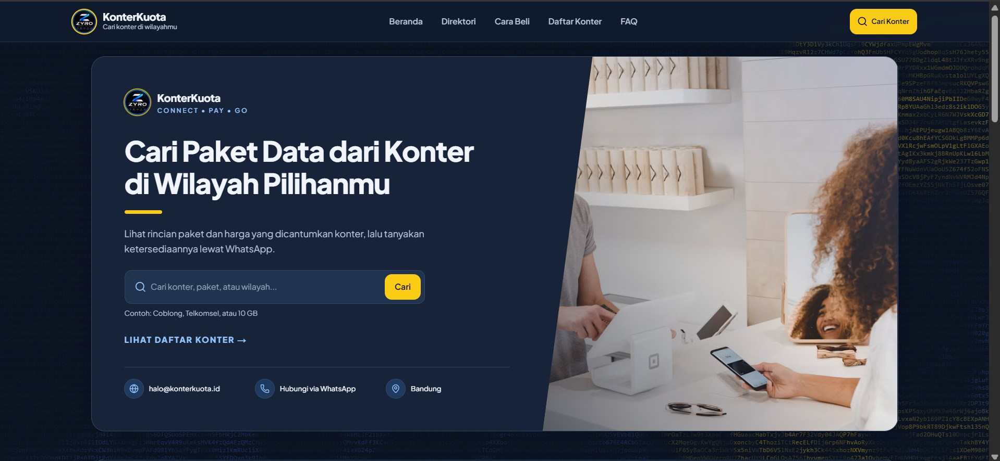

<div align="center">

# KonterKuota

**Direktori konter dan paket data untuk UMKM Indonesia.**

Cari konter di wilayahmu, lihat rincian paket, dan hubungi penjual melalui WhatsApp.

[](https://github.com/tegokkk/E-COMMERCE/actions/workflows/ci.yml)


[Fitur](#fitur) · [Instalasi](#menjalankan-secara-lokal) · [Pengujian](#pengujian) · [Deployment](#deployment) · [Dokumentasi](#dokumentasi)

</div>



## Tentang proyek

KonterKuota membantu konter pulsa dan paket data menampilkan usaha serta katalog mereka dalam satu direktori. Pengunjung dapat mencari berdasarkan lokasi, memilih provider, membandingkan informasi paket, lalu menanyakan ketersediaan langsung kepada penjual.

Platform menyediakan katalog dan sarana kontak. Pembayaran, kesepakatan transaksi, serta pengisian kuota dilakukan langsung antara pembeli dan pemilik konter.

## Fitur

| Untuk pengunjung                                      | Untuk pengelola                                         |
| ----------------------------------------------------- | ------------------------------------------------------- |
| Pencarian konter, paket, provider, dan lokasi         | Dashboard ringkasan katalog                             |
| Filter provinsi, kota/kabupaten, dan wilayah          | Pengelolaan profil dan publikasi konter                 |
| Informasi harga, kuota, masa aktif, dan ketersediaan  | Pengelolaan paket secara terpisah di setiap konter      |
| Detail konter, jam operasional, dan tautan Maps       | Pengaturan provider, wilayah, FAQ, dan kontak pengelola |
| Kontak WhatsApp sesuai konter atau paket yang dipilih | Unggah foto, atur batas tayang, dan ubah status paket   |
| Tampilan responsif untuk desktop dan perangkat mobile | Login admin, sesi tersimpan, dan konfirmasi penghapusan |

### Pengelolaan paket per konter

```text
Konter → Pilih konter terbit → Kelola Paket → Tambah / Edit Paket
```

Setiap konter memiliki daftar, pencarian, filter, jumlah, dan pagination paketnya sendiri. Konter pemilik ditetapkan otomatis pada form dan diperiksa kembali oleh backend pada setiap aksi.

Paket baru hanya dapat ditambahkan pada konter yang sudah terbit. Ketika konter dinonaktifkan, paket yang sudah ada tetap dapat dikelola, tetapi tidak ditampilkan pada katalog publik. Batas tayang mengikuti waktu lokal perangkat admin dan disimpan sebagai UTC.

## Teknologi

| Bagian           | Teknologi                                                                     |
| ---------------- | ----------------------------------------------------------------------------- |
| Frontend         | Next.js 16, React 19, Tailwind CSS 4, TanStack Query, Radix Dialog, Motion    |
| Backend          | Node.js 24 LTS, Express, Knex.js, PostgreSQL                                  |
| Validasi bersama | Zod melalui workspace `@konter/shared`                                        |
| Autentikasi      | Argon2id, express-session, PostgreSQL session store, CSRF, pemeriksaan Origin |
| Foto             | Sharp, penyimpanan lokal untuk development, private Vercel Blob untuk Vercel  |
| Pengujian        | Vitest, React Testing Library, Supertest, Playwright                          |
| Deployment       | Vercel untuk frontend/backend; Docker Compose dan Nginx sebagai alternatif    |

## Arsitektur

```text
Browser
   │
   ▼
Frontend · Next.js
   │
   │ /api/v1/*
   ▼
Backend · Express
   ├── PostgreSQL · katalog, akun, sesi, dan analitik
   └── Penyimpanan foto · lokal atau Vercel Blob
```

Browser mengakses API melalui domain frontend. Pola ini menjaga cookie admin tetap berada pada origin yang sama, sementara backend menangani validasi, otorisasi, dan akses database.

### Struktur repositori

```text
E-COMMERCE/
├── frontend/          # Halaman publik, panel admin, dan komponen UI
├── backend/           # REST API, migrasi, dan script operasional
├── shared/            # Skema validasi, konstanta, dan data lokasi
├── scripts/           # Helper konfigurasi deployment
├── tests/e2e/         # Pengujian browser desktop dan mobile
├── infra/             # Docker, Nginx, backup, dan verifikasi runtime
├── docs/              # Kontrak API, panduan deploy, dan banner README
└── .github/workflows/ # Continuous integration
```

## Menjalankan secara lokal

### Prasyarat

- Node.js **24 LTS** dan npm.
- PostgreSQL **15 atau lebih baru**. Konfigurasi Docker yang disediakan memakai PostgreSQL 17.
- Database aplikasi dan database pengujian yang terpisah.

### 1. Ambil repositori dan instal dependensi

```bash
git clone https://github.com/tegokkk/E-COMMERCE.git
cd E-COMMERCE
npm ci
```

### 2. Siapkan environment

Untuk PowerShell:

```powershell
Copy-Item backend/.env.example backend/.env
Copy-Item frontend/.env.example frontend/.env.local
```

<details>
<summary>Linux / macOS</summary>

```bash
cp backend/.env.example backend/.env
cp frontend/.env.example frontend/.env.local
```

</details>

Isi nilai sesuai lingkungan lokal. File contoh berisi placeholder, bukan kredensial siap pakai.

| Variabel            | Lokasi                | Kegunaan                                                     |
| ------------------- | --------------------- | ------------------------------------------------------------ |
| `DATABASE_URL`      | `backend/.env`        | Koneksi database aplikasi                                    |
| `TEST_DATABASE_URL` | `backend/.env`        | Koneksi database pengujian terpisah, bernama akhiran `_test` |
| `SESSION_SECRET`    | `backend/.env`        | Secret sesi acak, minimal 32 karakter                        |
| `PUBLIC_ORIGIN`     | `backend/.env`        | Origin frontend; lokal: `http://localhost:3000`              |
| `API_INTERNAL_URL`  | `frontend/.env.local` | Base URL API; lokal: `http://localhost:4000/api/v1`          |
| `SITE_URL`          | `frontend/.env.local` | URL publik situs; lokal: `http://localhost:3000`             |

Buat database yang dirujuk oleh kedua URL sebelum menjalankan migrasi. Jika menggunakan database development dari Docker Compose, isi `DEV_DB_PASSWORD` pada environment shell, lalu jalankan `docker compose up -d db`.

### 3. Jalankan migrasi dan buat admin

```bash
npm run db:migrate
npm run admin:create
```

Pembuatan admin dilakukan secara interaktif. Gunakan email dan password pilihan sendiri.

### 4. Jalankan aplikasi

```bash
npm run dev
```

| Layanan      | Alamat lokal                                                        |
| ------------ | ------------------------------------------------------------------- |
| Website      | [localhost:3000](http://localhost:3000)                             |
| Panel admin  | [localhost:3000/admin/login](http://localhost:3000/admin/login)     |
| Backend API  | [localhost:4000/api/v1](http://localhost:4000/api/v1)               |
| Health check | [localhost:4000/api/v1/health](http://localhost:4000/api/v1/health) |

Setelah masuk, isi kontak pengelola pada **Pengaturan**, tambahkan provider dan data lokasi yang diperlukan, lalu terbitkan konter dan paket pertama.

<details>
<summary>Opsional: data contoh untuk development</summary>

Seed menghapus dan mengisi ulang tabel development. Jalankan hanya pada database pengembangan yang memang boleh direset.

Isi `DEVELOPMENT_ADMIN_PASSWORD` dengan password minimal 12 karakter pada `backend/.env`, lalu jalankan:

```powershell
$env:ALLOW_DEVELOPMENT_SEED='true'
npm run db:seed
Remove-Item Env:ALLOW_DEVELOPMENT_SEED
```

Pada Linux/macOS:

```bash
ALLOW_DEVELOPMENT_SEED=true npm run db:seed
```

Akun contoh memakai email `admin@konterkuota.id` dan password dari environment tersebut. Konter contoh diberi label **Data contoh**, tombol kontaknya dinonaktifkan, dan datanya disembunyikan pada mode produksi. Seed menolak database produksi.

</details>

## Pengujian

### Pemeriksaan kode dan build

```bash
npm run lint
npm run build
npm run test --workspace=@konter/frontend
```

### Backend dengan database test terpisah

Pastikan `TEST_DATABASE_URL` mengarah ke database berakhiran `_test` dan berbeda dari `DATABASE_URL`. Siapkan skemanya terlebih dahulu:

```powershell
$env:NODE_ENV='test'
npm run db:migrate
npm run test --workspace=@konter/backend -- tests/unit tests/integration/counter-packages.test.js tests/integration/catalog-locations.test.js
Remove-Item Env:NODE_ENV
```

Perintah pengujian terpilih di atas tidak menjalankan seed. Fixture pengujian dibuat dalam database test dan dibersihkan setelah selesai. Suite integrasi lainnya dapat mengisi ulang fixture pada database test.

### Pengujian browser

Jalankan frontend lokal, siapkan database test yang sudah dimigrasi, dan buat build produksi untuk skenario lokasi publik:

```bash
npm run build
npx playwright install chromium
```

Lalu jalankan dari PowerShell:

```powershell
$env:NODE_ENV='test'
$env:COUNTER_PACKAGE_E2E='true'
npx playwright test tests/e2e/admin.spec.js tests/e2e/counter-packages.spec.js tests/e2e/public-locations.spec.js --workers=1
Remove-Item Env:NODE_ENV
Remove-Item Env:COUNTER_PACKAGE_E2E
```

Skenario mencakup proteksi admin, isolasi paket antar konter, perubahan status, pencarian lokasi, serta preservasi batas tayang di zona UTC+7. `PLAYWRIGHT_CHROME_PATH` dapat diisi jika ingin memakai instalasi Chrome lokal.

## Deployment

### Vercel

Gunakan dua project dari repositori yang sama:

| Project  | Root Directory | Framework | Build Command          |
| -------- | -------------- | --------- | ---------------------- |
| Backend  | `backend`      | Express   | `npm run vercel:build` |
| Frontend | `frontend`     | Next.js   | `npm run build`        |

Konfigurasi proyek tersedia di [backend/vercel.json](backend/vercel.json) dan [frontend/vercel.json](frontend/vercel.json). Aktifkan akses source di luar Root Directory agar workspace `shared` ikut tersedia.

- Gunakan PostgreSQL online dan private Blob store yang terhubung ke project backend.
- Arahkan `PUBLIC_ORIGIN` ke domain frontend dan `API_INTERNAL_URL` ke URL backend dengan suffix `/api/v1`.
- Isi `SITE_URL` dengan domain frontend untuk metadata situs.
- Build backend menjalankan migrasi dan membuat admin pertama hanya jika belum ada. Build ini tidak menjalankan seed.
- Gunakan environment terpisah untuk Preview dan Production.

Panduan lengkap tersedia di [Deploy Vercel + PostgreSQL/Supabase](docs/DEPLOY_VERCEL_SUPABASE.md). Helper interaktif `npm run vercel:env` tersedia untuk menyiapkan file environment lokal yang diabaikan Git; simpan hasilnya sebagai kredensial privat.

### Docker Compose

Untuk deployment pada server Linux, ikuti [panduan operasional](docs/operations.md). Konfigurasi mencakup Nginx, TLS, migrasi sebelum startup, volume database dan foto, health check, serta prosedur backup dan restore.

Setelah build frontend, konfigurasi runtime dapat diperiksa dengan:

```bash
node infra/check-frontend-runtime.mjs
```

## Perintah yang sering digunakan

| Perintah                                              | Fungsi                                                          |
| ----------------------------------------------------- | --------------------------------------------------------------- |
| `npm run dev`                                         | Menjalankan frontend dan backend                                |
| `npm run dev:frontend`                                | Menjalankan frontend saja                                       |
| `npm run dev:backend`                                 | Menjalankan backend saja                                        |
| `npm run build`                                       | Membuat build produksi frontend                                 |
| `npm run lint`                                        | Memeriksa kode dengan ESLint                                    |
| `npm run db:migrate`                                  | Menerapkan migrasi pada database sesuai environment             |
| `npm run admin:create`                                | Membuat akun admin secara interaktif                            |
| `npm run admin:reset-password`                        | Mereset password dan mencabut sesi admin terkait                |
| `npm run vercel:env`                                  | Membuat file konfigurasi deployment secara interaktif           |
| `npm run analytics:report`                            | Menampilkan laporan analitik                                    |
| `npm run analytics:cleanup`                           | Membersihkan event analitik yang melewati retensi               |
| `npm run uploads:cleanup --workspace=@konter/backend` | Membersihkan foto tidak terpakai yang lebih tua dari tujuh hari |

## Keamanan dan operasional

- Password di-hash menggunakan Argon2id; sesi admin disimpan di PostgreSQL.
- Mutasi admin dilindungi autentikasi, CSRF, dan pemeriksaan Origin.
- Hubungan paket dan konter diperiksa di backend pada setiap aksi terkait.
- Foto diperiksa dan dikonversi ke WebP; batas unggah **4 MB** dan **20 megapiksel**.
- Pada Vercel, pembatasan request memakai penghitung bersama di PostgreSQL dan pemeliharaan terjadwal dilindungi `CRON_SECRET`.
- File environment, token, dan hasil generator kredensial tidak boleh dimasukkan ke commit.

## Dokumentasi

| Dokumen                                                                   | Isi                                                   |
| ------------------------------------------------------------------------- | ----------------------------------------------------- |
| [Kontrak REST API](docs/api.md)                                           | Endpoint, format respons, filter, dan validasi        |
| [Deployment Vercel + PostgreSQL/Supabase](docs/DEPLOY_VERCEL_SUPABASE.md) | Konfigurasi project, database, Blob, dan environment  |
| [Operasional Docker](docs/operations.md)                                  | Rilis, TLS, backup, restore, pemantauan, dan rollback |
| [Audit kesiapan deployment](docs/DEPLOY_READINESS_2026-11-16.md)          | Temuan audit, tindak lanjut, dan batas verifikasi     |

## Kontribusi

Laporkan bug atau usulkan perbaikan melalui [GitHub Issues](https://github.com/tegokkk/E-COMMERCE/issues). Sertakan langkah reproduksi, perilaku yang diharapkan, dan informasi lingkungan. Untuk perubahan kode, jelaskan ruang lingkup perubahan serta pemeriksaan yang sudah dijalankan pada pull request.
