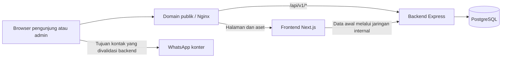

# Tech Stack — Landing Page Konter Kuota UMKM

| Informasi       | Keterangan                                                                     |
| --------------- | ------------------------------------------------------------------------------ |
| Tanggal         | 5 November 2026                                                                |
| Acuan kebutuhan | [PRD.md](./PRD.md)                                                             |
| Acuan struktur  | [STRUCTURE_PROJECT.md](./STRUCTURE_PROJECT.md)                                 |
| Bahasa aplikasi | JavaScript dengan ES Modules (`import` / `export`)                             |
| Arsitektur      | Frontend Next.js dan backend Express yang terpisah dalam satu repositori       |
| Status          | Keputusan teknis untuk implementasi; aplikasi belum dibuat melalui dokumen ini |

## 1. Keputusan Utama

Stack yang digunakan adalah **Next.js + React + Tailwind CSS untuk frontend, Node.js + Express untuk backend, serta PostgreSQL + Knex untuk database**.

Seluruh kode aplikasi ditulis dalam JavaScript: `.js` untuk logika dan `.jsx` untuk komponen React. Konfigurasi menggunakan `.js`/`.mjs`, JSON, atau YAML sesuai kebutuhan alat. JSX adalah sintaks untuk menulis tampilan React di dalam JavaScript. Proyek menggunakan `jsconfig.json` untuk alias import.

Frontend melayani landing page dan panel admin. Backend menjadi pemilik API, autentikasi, aturan katalog, serta akses database. Pembagian ini membuat bagian tampilan dan pengelolaan data dapat dikembangkan secara terpisah dengan kontrak yang jelas.

## 2. Ringkasan Stack

| Lapisan             | Pilihan                                                                                                                                             | Penggunaan pada proyek                                                                                 |
| ------------------- | --------------------------------------------------------------------------------------------------------------------------------------------------- | ------------------------------------------------------------------------------------------------------ |
| Runtime             | [Node.js 24 LTS](https://nodejs.org/en/about/previous-releases)                                                                                     | Menjalankan frontend server, backend, dan tooling dalam versi runtime yang sama.                       |
| Package manager     | npm dengan workspaces                                                                                                                               | Mengelola `frontend`, `backend`, dan `shared` dari satu lockfile.                                      |
| Framework frontend  | [Next.js 16, App Router](https://nextjs.org/docs/app/getting-started/installation)                                                                  | Routing, rendering halaman awal, metadata SEO, dan optimasi aset.                                      |
| UI                  | React dan React DOM versi yang kompatibel dengan Next.js                                                                                            | Komponen landing page, direktori, dialog detail, dan panel admin.                                      |
| Styling             | [Tailwind CSS 4](https://tailwindcss.com/docs/installation/framework-guides/nextjs)                                                                 | Layout responsif, warna merek, tipografi, dan keadaan interaksi.                                       |
| Dialog              | [Radix Dialog](https://www.radix-ui.com/primitives/docs/components/dialog)                                                                          | Dasar panel detail konter dengan pengelolaan fokus dan navigasi keyboard.                              |
| Data di browser     | [TanStack Query 5](https://tanstack.com/query/latest/docs/framework/react/reference/functions/useQuery)                                             | Loading/error state, cache per filter, penyegaran data, dan invalidasi setelah perubahan.              |
| Request HTTP        | `fetch` bawaan                                                                                                                                      | Komunikasi JSON dengan backend.                                                                        |
| Framework backend   | [Express 5](https://expressjs.com/en/starter/installing/)                                                                                           | REST API untuk katalog, autentikasi, admin, dan analitik ringan.                                       |
| Database            | [PostgreSQL 17](https://www.postgresql.org/support/versioning/)                                                                                     | Menyimpan konter, paket, provider, wilayah, admin, sesi, dan pengaturan.                               |
| Akses database      | [Knex](https://knexjs.org/guide/) + `pg`                                                                                                            | Query SQL melalui JavaScript, connection pool, transaksi, dan migrasi skema.                           |
| Validasi            | [Zod 4](https://zod.dev/)                                                                                                                           | Skema input JavaScript yang digunakan frontend dan backend.                                            |
| Environment backend | `dotenv` + validasi Zod                                                                                                                             | Memuat `.env` lokal sebelum memvalidasi konfigurasi; produksi memakai environment dari host/container. |
| Sesi admin          | [express-session](https://expressjs.com/en/resources/middleware/session/) + [connect-pg-simple](https://github.com/voxpelli/node-connect-pg-simple) | Cookie berisi ID sesi; data sesi disimpan di PostgreSQL.                                               |
| Password            | `argon2`, menggunakan Argon2id                                                                                                                      | Hash password admin.                                                                                   |
| Proteksi request    | `helmet`, `express-rate-limit`, [csrf-sync](https://github.com/Psifi-Solutions/csrf-sync)                                                           | Header keamanan, batas percobaan login, dan token CSRF untuk operasi berbasis sesi.                    |
| Logging             | `pino` + `pino-http`                                                                                                                                | Log terstruktur dengan penyamaran data rahasia.                                                        |
| Pemeriksaan kode    | ESLint + Prettier                                                                                                                                   | Konsistensi JavaScript, React, dan format kode.                                                        |
| Tooling lokal       | `concurrently` dan `@inquirer/prompts`                                                                                                              | Menjalankan dua aplikasi bersamaan dan menerima password admin melalui prompt tersembunyi.             |
| Pengujian           | Vitest, React Testing Library, Supertest, Playwright                                                                                                | Menguji aturan katalog, interaksi, API, dan alur pengguna utama.                                       |
| Lingkungan lokal    | Docker Compose untuk PostgreSQL                                                                                                                     | Database lokal yang konsisten; frontend dan backend dapat berjalan langsung melalui npm.               |
| Deployment awal     | Container Node.js pada VPS Linux, Nginx sebagai reverse proxy                                                                                       | Satu domain publik dengan routing ke dua aplikasi.                                                     |

Versi di atas adalah baseline yang dipilih, bukan klaim bahwa semuanya merupakan versi terbaru. Gunakan patch stabil terbaru dalam major tersebut ketika proyek dibuat, cocokkan peer dependency React/Next.js, lalu kunci hasilnya melalui `package-lock.json`. Pin versi Node yang sama pada lokal, CI, dan container. Pembaruan dependency dilakukan melalui perubahan yang diuji.

## 3. Frontend

### 3.1 Rendering dan SEO

Halaman utama mengambil konten dan daftar awal konter dari Express pada server Next.js, kemudian mengirim HTML berisi informasi tersebut. Pencarian, filter, dialog, dan formulir menjadi komponen interaktif di browser. Pembagian ini mengikuti model [Server dan Client Components Next.js](https://nextjs.org/docs/app/getting-started/server-and-client-components).

- Gunakan Server Components untuk halaman awal, metadata, dan pengambilan data awal.
- Gunakan Client Components pada interaksi yang memerlukan state, event, atau API browser.
- Halaman admin diberi metadata `noindex` dan seluruh pengambilan datanya memerlukan sesi valid.
- Header, hero, cara beli, CTA mitra, FAQ, dan footer merupakan komponen tersendiri.
- Halaman publik awal mencakup `/` dan `/privasi`; detail konter menggunakan dialog sesuai MVP pada PRD.

### 3.2 Data dan state

- State lokal React menyimpan dialog aktif, input sementara, dan state formulir.
- TanStack Query menyimpan hasil API dengan key yang mencakup kata kunci, provider, wilayah, dan halaman hasil.
- Data awal dari server hanya menjadi `initialData` bagi query dengan parameter yang sama. Jangan mengisi query filter baru dengan data awal tanpa filter.
- Query pencarian menggunakan debounce sekitar 300 ms dan membatalkan request lama melalui `AbortSignal`.
- Validasi formulir memakai Zod dari workspace `shared`. Backend tetap memvalidasi ulang seluruh input.

### 3.3 Kesegaran informasi

Target PRD adalah pembaruan publik maksimal 60 detik dalam kondisi koneksi normal. Strategi MVP:

1. Pengambilan katalog pada server menggunakan `cache: 'no-store'`; respons API katalog juga tidak disimpan pada cache HTTP bersama. Lihat [pengambilan data Next.js](https://nextjs.org/docs/app/getting-started/fetching-data).
2. Daftar konter dan detail yang sedang terlihat melakukan refetch setiap 30 detik melalui TanStack Query. Provider dan wilayah ikut diperbarui bila berubah.
3. Saat tab kembali aktif atau koneksi pulih, aplikasi mengambil data terbaru.
4. Perubahan admin menginvalidasi query terkait pada sesi admin. Pengunjung lain menerima perubahan pada refetch berikutnya.
5. Paket yang melewati `displayUntil` juga disembunyikan di tampilan berdasarkan waktu kedaluwarsanya. Backend tetap menjadi sumber keputusan final saat kontak dibuka.

Saat offline atau API gagal, tampilkan penanda bahwa informasi belum dapat diperbarui dan tombol coba lagi. Target 60 detik tidak berarti data dapat diperbarui ketika perangkat tidak terhubung.

### 3.4 Gambar

MVP menyimpan URL gambar HTTPS dari host yang diizinkan. Admin dapat memasukkan URL aset yang sudah tersedia. Gambar contoh dan placeholder disimpan di `frontend/public/images/`.

Gunakan `next/image` dengan daftar `remotePatterns` yang sesuai host aset. Validasi host di backend; jangan menerima URL arbitrer untuk diteruskan sebagai permintaan server. Fitur unggah langsung dapat ditambahkan kemudian dengan object storage dan batas format/ukuran dari PRD.

## 4. Backend

### 4.1 Bentuk API

Backend menyediakan REST API JSON dengan awalan `/api/v1`. Kebutuhan MVP berupa request biasa: membaca katalog, login, memperbarui data, dan mencatat event. Satu aplikasi Express menangani kebutuhan ini.

Alur setiap fitur:

```text
Route -> Middleware -> Controller -> Service -> Repository -> PostgreSQL
```

- **Route:** menetapkan URL, metode HTTP, dan middleware.
- **Middleware:** memeriksa sesi, peran, token CSRF, dan input.
- **Controller:** membaca request dan membentuk respons HTTP.
- **Service:** menjalankan aturan bisnis dari PRD.
- **Repository:** menjalankan query database melalui Knex.

Logika kelayakan paket publik dipusatkan di modul katalog. Daftar, detail, pencarian, harga minimum, dan tujuan WhatsApp menggunakan aturan yang sama.

### 4.2 Data dan migrasi

Tabel awal: `admins`, `admin_sessions`, `regions`, `counters`, `providers`, `packages`, `platform_settings`, dan `analytics_events`. Relasi dan foreign key menjaga paket tetap terhubung ke konter serta provider yang benar.

- ID data bisnis menggunakan UUID. Skema `admin_sessions` mengikuti format yang diperlukan `connect-pg-simple`.
- Harga memakai integer Rupiah dengan batas positif, sehingga tidak menggunakan floating point.
- Waktu disimpan sebagai `timestamptz` dan dikirim melalui API sebagai ISO 8601.
- Zona waktu tampilan berasal dari konfigurasi wilayah pilot. Tanggal batas tayang dari admin dikonversi secara eksplisit sebelum disimpan.
- Status publikasi: `draft`, `published`, `inactive`.
- Status ketersediaan paket: `available`, `needs_confirmation`, `unavailable`; frontend menampilkan padanan bahasa Indonesia.
- Pencarian, filter AND, dan harga minimum dihitung backend. Parameter query di-bind melalui Knex.
- Paket kedaluwarsa dikeluarkan pada query baca; tidak membutuhkan pekerjaan terjadwal hanya untuk menyembunyikan penawaran.
- Migrasi ditulis dalam JavaScript melalui [Knex migrations](https://knexjs.org/guide/migrations.html) dan dicatat di Git.
- Seed data fiktif hanya dijalankan pada development/test. Akun admin produksi dibuat melalui script khusus dengan input password tersembunyi.

### 4.3 Autentikasi admin

Admin menggunakan email dan password. Sesi disimpan di PostgreSQL, sehingga login tidak hilang hanya karena proses backend restart. `express-session` menyimpan ID sesi pada cookie, sedangkan data sesi berada di server; penyimpanan default `MemoryStore` tidak dipakai pada produksi. [Dokumentasi sesi Express](https://expressjs.com/en/resources/middleware/session/).

Ketentuan implementasi:

- Cookie produksi menggunakan `HttpOnly`, `Secure`, `SameSite=Lax`, `Path=/`, dan domain host saja.
- Masa sesi absolut awal 8 jam; login berhasil mengganti ID sesi, logout menghapus sesi dan cookie.
- `GET /auth/csrf` membuat sesi awal dan mengembalikan token CSRF. Login, logout, dan mutasi admin menyertakan token pada header `X-CSRF-Token`.
- Setelah regenerasi sesi saat login, frontend mengambil token CSRF baru sebelum mutasi berikutnya.
- Backend memeriksa status akun dan peran admin pada seluruh endpoint admin. Proteksi UI hanya membantu pengalaman pengguna.
- Percobaan login dibatasi dan pesan gagal tidak mengungkap apakah email terdaftar.
- Akun admin dibuat dan password direset melalui script operasional. Pendaftaran admin publik tidak disediakan.
- Sesi hanya dimuat pada endpoint autentikasi/admin; pembacaan katalog publik tidak membutuhkan sesi login.

### 4.4 Analitik sederhana

Event pada PRD dikirim ke `POST /api/v1/events`, kemudian disimpan di PostgreSQL. Tambahkan event teknis `page_view` untuk menghitung jumlah sesi pengunjung sebagai penyebut rasio klik WhatsApp.

ID sesi analitik berupa UUID acak dalam `sessionStorage`, terpisah dari sesi admin. Definisi sesi pilot adalah satu sesi tab browser; metrik bukan jumlah orang unik. Kirim `page_view` sekali per ID sesi dan keluarkan kunjungan admin/pengujian dari laporan.

Backend membatasi jenis event, ukuran payload, dan properti yang diterima. Nomor telepon, pesan WhatsApp, kata kunci pencarian mentah, serta credential tidak menjadi properti analitik. Gunakan ID entitas, posisi tombol, dan jumlah hasil. Event dikirim tanpa menunggu hasilnya sebelum navigasi WhatsApp. Laporan pilot awal dihasilkan melalui script; dashboard analitik khusus dapat ditambahkan setelah pilot.

## 5. Komunikasi Frontend dan Backend



Browser mengakses API melalui path relatif `/api/v1`, pada origin yang sama dengan website. Produksi menggunakan Nginx untuk meneruskan path tersebut ke Express; development menggunakan rewrite Next.js. Path `/api/v1` tetap utuh ketika diteruskan.

Server Next.js menggunakan `API_INTERNAL_URL` untuk membaca data awal dari Express. Frontend tidak memiliki credential database. Seluruh operasi data bisnis berada di Express; Next.js menangani tampilan dan pengambilan data untuk rendering.

Pendekatan satu origin membuat cookie login dapat digunakan tanpa konfigurasi cookie lintas domain. Backend hanya mempercayai proxy yang diketahui dan menerima header protokol HTTPS yang diteruskan proxy.

## 6. Environment Variables

| Lokasi                | Variabel              | Fungsi                                                                                    |
| --------------------- | --------------------- | ----------------------------------------------------------------------------------------- |
| Frontend, server saja | `API_INTERNAL_URL`    | Contoh lokal `http://localhost:4000/api/v1`; pada container `http://backend:4000/api/v1`. |
| Frontend, server saja | `SITE_URL`            | Origin publik untuk canonical dan metadata.                                               |
| Frontend, server saja | `IMAGE_ALLOWED_HOSTS` | Host gambar yang diizinkan pada konfigurasi image.                                        |
| Backend               | `PORT`                | Port Express, default lokal 4000.                                                         |
| Backend               | `DATABASE_URL`        | Koneksi PostgreSQL aplikasi.                                                              |
| Backend               | `TEST_DATABASE_URL`   | Database terpisah untuk pengujian integrasi.                                              |
| Backend               | `SESSION_SECRET`      | Rahasia penandatanganan cookie, dihasilkan acak dan disimpan privat.                      |
| Backend               | `PUBLIC_ORIGIN`       | Origin yang diizinkan untuk request admin dan pemeriksaan Origin.                         |
| Backend               | `TRUST_PROXY`         | Konfigurasi proxy sesuai topologi deployment; default lokal nonaktif.                     |
| Backend               | `DISPLAY_TIME_ZONE`   | Zona waktu IANA wilayah pilot.                                                            |
| Backend               | `IMAGE_ALLOWED_HOSTS` | Allowlist host URL gambar; selaras dengan frontend.                                       |
| Backend               | `ANALYTICS_ENABLED`   | Menonaktifkan pencatatan pada development/test.                                           |
| Backend               | `LOG_LEVEL`           | Tingkat log aplikasi.                                                                     |
| Keduanya              | `NODE_ENV`            | Mode development, test, atau production sesuai runtime.                                   |

Frontend memakai `.env.local`, backend memakai `.env`, dan keduanya memiliki `.env.example` tanpa rahasia. File rahasia dikecualikan dari Git. Backend memvalidasi environment saat startup dan berhenti dengan pesan jelas bila konfigurasi wajib belum tersedia.

Nama platform, FAQ, dan WhatsApp pengelola disimpan sebagai data `platform_settings` agar dapat diperbarui melalui admin. Browser menggunakan path API relatif sehingga tidak memerlukan `NEXT_PUBLIC_API_URL`.

## 7. Deployment dan Operasional

Baseline deployment adalah satu VPS Linux dengan container frontend, backend, PostgreSQL, serta Nginx. Pilihan penyedia VPS dan domain ditetapkan saat deployment; dokumen ini tidak mengasumsikan pembelian layanan.

- Nginx menerima HTTPS; hanya port web yang dibuka ke publik. API dan database menggunakan jaringan internal.
- PostgreSQL memakai volume persisten. Backup harian disimpan di lokasi terpisah dan prosedur pemulihannya diuji sebelum peluncuran.
- Build frontend dijalankan dengan `next build` dan disajikan menggunakan proses Node.js produksi. Backend berjalan dengan `node src/server.js`.
- Jalankan migrasi sekali sebagai langkah release sebelum aplikasi baru menerima trafik. Seed fiktif tidak termasuk langkah release.
- Log menyamarkan password, cookie, token CSRF, session secret, dan URL kontak yang mengandung nomor/pesan. Query pencarian mentah juga dikeluarkan dari log request.
- CI menjalankan install dari lockfile, lint, pengujian yang relevan, dan build frontend. Pengujian integrasi memakai database terisolasi.

Pilihan ini memerlukan pengelola untuk pembaruan server, sertifikat HTTPS, dan backup. Hosting terkelola dapat menggantikan VPS kemudian dengan mempertahankan kontrak API dan satu origin publik.

## 8. Verifikasi Implementasi

| Area          | Pemeriksaan yang diperlukan                                                                                    |
| ------------- | -------------------------------------------------------------------------------------------------------------- |
| Katalog       | Paket nonaktif/kedaluwarsa tidak muncul; filter digabung AND; harga minimum mengikuti paket yang layak tampil. |
| Admin         | API menolak request tanpa sesi/peran yang benar dan token CSRF yang diperlukan.                                |
| Penyimpanan   | Perubahan tetap tersedia setelah backend restart dan database dimuat ulang.                                    |
| Kontak        | Konter dan paket diperiksa ulang sebelum URL WhatsApp diberikan; tujuan sesuai penjual.                        |
| Frontend      | Daftar awal ada dalam HTML; keadaan loading, kosong, gagal, serta penyegaran data bekerja.                     |
| Aksesibilitas | Dialog dapat digunakan dengan keyboard dan fokus kembali ke pemicu.                                            |
| Analitik      | Gagal mengirim event tidak menggagalkan kontak; payload tidak berisi data yang dilarang.                       |
| Rilis         | Build produksi, alur ponsel/desktop, dan target performa pada PRD diperiksa.                                   |

Dokumen ini menetapkan rancangan stack. Hasil uji kompatibilitas, performa, dan deployment dicatat setelah implementasi tersedia.
